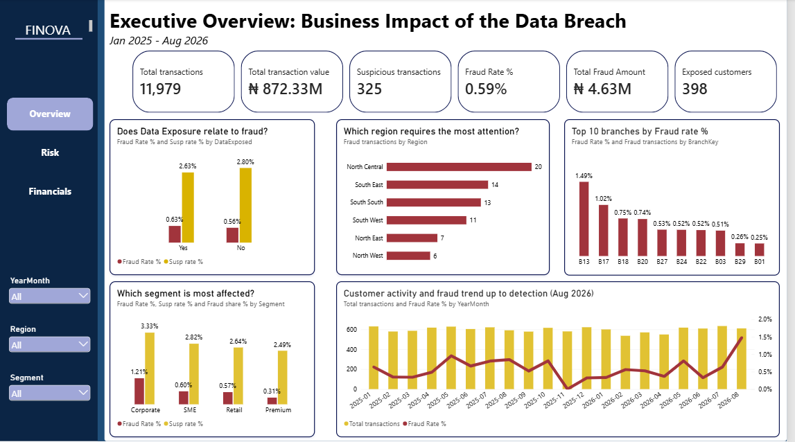
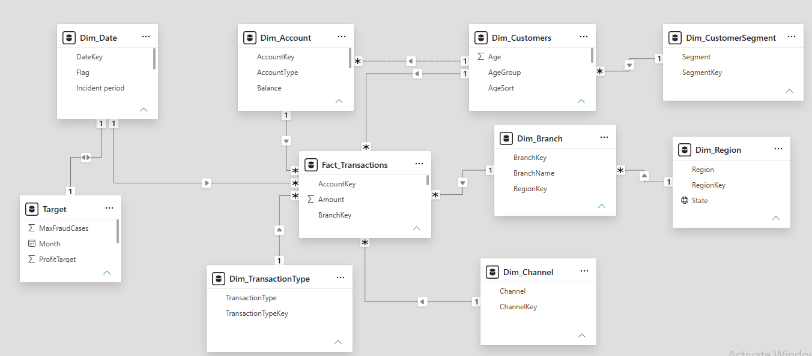
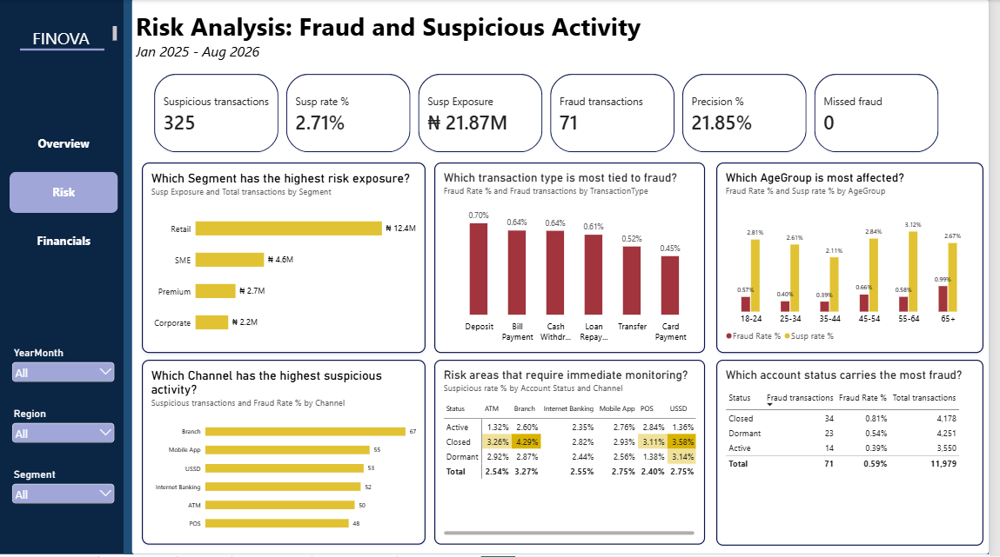
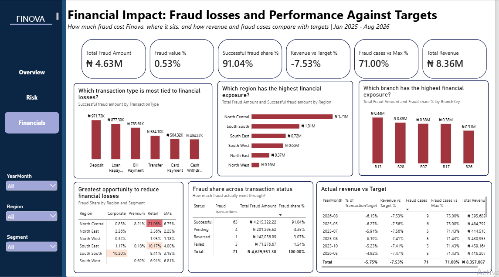

# Finova-Data-Breach-Analysis

An end-to-end analysis of how a customer data breach affected fraud, risk and financial performance at a fictional Nigerian bank, delivered as a 3-page Power BI dashboard for the CEO, CRO and CFO. This project was done as part of the Databeauty Tribe Business Challenge, Case 002 (BCS-002).



## Table of Contents
- [Business Problem](#business-problem)
- [Dataset](#dataset)
- [Data Cleaning](#data-cleaning)
- [Analysis Approach](#analysis-approach)
- [Key Findings](#key-findings)
- [Recommendations](#recommendations)
- [Limitations](#limitations)
- [Repository Structure](#repository-structure)
- [Tools Used](#tools-used)
- [Author](#author)

## Business Problem

Finova Financial Group is a financial services company founded in 2012 and headquartered in Lagos, Nigeria. It serves individuals, SMEs and corporate customers through branches, ATMs, mobile apps, internet banking and POS terminals.

In August 2026, Finova detected unauthorised access to customer contact details (emails and phone numbers). Core banking systems were not reported to be compromised, but exposed customers could become targets of phishing, impersonation and fraud.

The Executive Board asked one central question:

> Who is most exposed, where is the risk concentrated, what is the financial impact, and which areas should management prioritise?

The analysis answers this for three executives:

| Executive | Focus |
|---|---|
| CEO | Overall business impact, affected segments, regions and branches, customer activity, priorities |
| CRO | Risk exposure by segment, channel and transaction type, hotspots, immediate monitoring |
| CFO | Financial impact of fraud, loss drivers, financial exposure, actual vs targets, risk areas to reduce loss |

## Dataset

A single-fact-table star schema covering **January 2025 to August 2026**.

- **Fact table:** `Fact_Transactions`
- **Dimensions:** `Dim_Date`, `Dim_Customer`, `Dim_Account`, `Dim_Branch`, `Dim_Region`, `Dim_Channel`, `Dim_TransactionType`, `Dim_CustomerSegment`
- **Targets:** monthly revenue, profit, transaction and maximum fraud case targets



> The raw dataset is provided by the Databeauty Tribe and is not included in this repository.

## Data Cleaning

The data contained deliberate real-world inconsistencies. Steps taken:

| Check | Result |
|---|---|
| Duplicate transaction IDs | 5 removed (12,005 to 12,000 rows) |
| Null `Amount` values | 21 rows removed |
| Outliers (IQR) | Reviewed and kept as valid transactions |
| Orphan keys between tables | None found |
| Date range | January 2025 to 31 August 2026 |
| Flag columns | Only Yes/No values |

**Final dataset: 11,979 transactions.**

Full documentation: [`docs/Data_Cleaning_Documentation.pdf`](docs/Data_Cleaning_Documentation.pdf)

## Analysis Approach

- **Cleaning and validation:** Power Query in Power BI, cross-checked in MySQL.
- **Analysis:** DAX measures in Power BI, with the key figures validated using SQL (`sql/Finova_fraud_analysis.sql`).
- **Visualisation:** a 3-page Power BI dashboard (Overview/CEO, Risk/CRO, Financials/CFO).
- **Key definition:** a **suspicious flag is not confirmed fraud**. Confirmed fraud means `FraudFlag = Yes`.

Alert performance was measured with:
- **Precision** = confirmed fraud among suspicious alerts ÷ all suspicious alerts
- **Recall** = confirmed fraud caught by alerts ÷ all confirmed fraud

## Key Findings

- **71 confirmed fraud cases** across 11,979 transactions, with about **₦4.63 million** in fraud exposure.
- **91%** of fraud exposure went through as successful transactions.
- **Fraud rate rose to 1.47% in August 2026**, up from 0.63% in July.
- **Alerts missed no fraud (recall 100%)**, but only about 22% of alerts were real fraud, so **about 78% were false alarms**.
- **398 of 800 customers (nearly half)** had their data exposed, yet there is **no clear link between exposure and fraud yet**.
- **Revenue is about 7.5% below target and transactions about 5.7% below**, a gap that existed before the breach and points to low volume rather than breach impact.
- **Risk is concentrated** in the North Central region, branches 13 and 17, and the Corporate and Retail segments.
- By age, customers **65+ had the highest fraud rate (0.99%)**, followed by 45 to 54.




## Recommendations

1. **Protect exposed customers:** proactive phishing warnings, stronger verification on sensitive changes, closer monitoring of the 398 exposed customers.
2. **Strengthen monitoring in high-risk areas:** North Central, branches 13 and 17, Corporate and Retail customers, and older customers.
3. **Reduce false alarms without missing fraud:** tune alert rules to improve precision while keeping recall at 100%.
4. **Re-run the analysis with post-breach data** to test the exposure-to-fraud link properly.

Full documentation: [`docs/Analysis Report.pdf`](docs/Analysis Report.pdf)

## Limitations

- The data ends in August 2026, the month the breach was detected, so there is **no post-breach period** to compare. The analysis does not claim the breach caused the fraud increase.
- The dataset is simulated for a business challenge.

## Repository Structure

```
finova-data-breach-analysis/
├── README.md
├── sql/
│   └── Finova_fraud_analysis.sql
├── dashboard/
│   ├── Finova_Analysis.pbix
├── docs/
│   ├── Data_Cleaning_Documentation.pdf
│   └── Analysis_Report.pdf
└── DBT_Images/
    ├── data_model.png
    ├── CEO.png
    ├── CRO.png
    └── CFO.png
```

## Tools Used

- **Power BI:** Power Query, DAX, data modelling, dashboards
- **MySQL:** validation and cross-checking
- **Microsoft Word:** documentation and reporting

## Author

**Eseonu Rejoice Adaeze**, pharmacy graduate transitioning into data analytics.

- LinkedIn: [www.linkedin.com/in/eseonu-rejoice-adaeze-999488413]
- Medium article: [(https://medium.com/@rejoice2306/when-customer-data-leaks-where-does-the-fraud-show-up-analyzing-the-finova-data-breach-fc691dba245b)]
- TikTok: [https://vt.tiktok.com/ZSgovrdAb/]

*Project completed for the Databeauty Tribe Business Challenge, Case 002, with my group, Pearl Pod.*
